# 🖍️ crayon.h

**Website:** see `docs/` (turn on GitHub Pages to host it).

**The easiest way to draw, make games and make apps in C.**
One file. No setup. No libraries to link. Just `#include` it and go.

```sh
gcc main.c -o main && ./main
```

```c
#include "crayon.h"

int main(void) {
    window(600, 400);
    arrow();

    forward(100);
    right(90);
    forward(100);
    right(90);
    forward(100);
    right(90);
    forward(100);
    right(90);
}
```

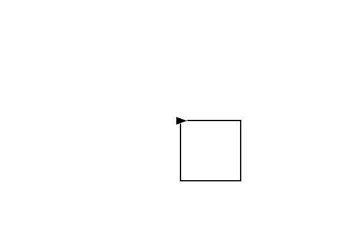

That's the whole program. No event loop, no setup code, no cleanup. The window stays open by itself.

---

## Install

**Option 1 — keep it next to your code.** Put `crayon.h` in the same folder as your `.c` file and use quotes:

```c
#include "crayon.h"
```

**Option 2 — install it once, use it everywhere.** Then you can use `<crayon.h>` from any folder:

```sh
sudo cp crayon.h /usr/local/include/
```

```c
#include <crayon.h>
```

> `<crayon.h>` with angle brackets only works if it's installed (option 2), or if you compile with
> `gcc main.c -o main -I.` &nbsp;•&nbsp; You don't need `#include <stdio.h>` or `<string.h>` — crayon already includes them.

Put your `.png` pictures in the folder you run the program from.

---

## Why crayon?

Most C graphics libraries make you write 50 lines before you see a single pixel —
create a renderer, load fonts, write an event loop, free everything at the end.

With crayon you write what you **mean**:

| You want to... | You write |
|---|---|
| draw a line | `forward(100);` |
| show a picture | `image("cat.png", 0, 0);` |
| write colorful text | `text("{red}Hi {blue}there", 0, 0);` |
| ask a question | `name = userinput("Your name?");` |
| make a button | `button("Play", 0, -100, play);` |
| move a character | `key(UP) forward(4);` |

It's only one header file, and it builds with plain `gcc` — no `-lX11`, no `-lpng`, no CMake.

---

## Where things go (coordinates)

The middle of the window is **(0, 0)**. **x** goes right (negative = left), **y** goes up (negative = down).
A `window(800, 500)` goes from **-400 to 400** across and **-250 to 250** up and down.

```c
window(800, 500);
grid();          // draws the numbers on screen
show_coords();   // shows where your mouse is - hover where you want something, copy the numbers
```

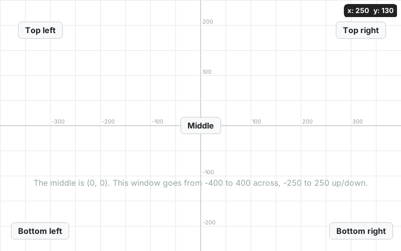

Every function that puts something on screen takes the **x, y** after the words:

```c
text("Hello", -300, 200);              // words start at (-300, 200)
text_center("Title", 0, 200);          // words centered on (0, 200)
button("Play", 0, -100, play);         // button centered on (0, -100)
image("logo.png", 0, 150);             // picture centered on (0, 150)
inputbox("Type...", 0, -200, 500, fn); // box centered on (0, -200), 500 wide
userinput("?:", 0, 50);                // ask, with the box centered on (0, 50)
```

## Buttons anywhere

```c
void hi(void) {                         // what happens when it's clicked
    text_center("{green}You clicked a button!", 0, 40);
}

int main(void) {
    window(800, 500);

    button("Top left",     -320,  190, hi);
    button("Top right",     320,  190, hi);
    button("Middle",          0,    0, hi);
    button("Bottom left",  -320, -190, hi);
    button("Bottom right",  320, -190, hi);
}
```

- `button("words", x, y, function)` — the function runs every time it's clicked.
- `button_color("blue", "white");` — set the colors **before** making the button.
- `textsize(20);` before a button makes its words bigger.
- `link("words", x, y, function)` — same thing, but it looks like clickable text.
- `remove_button("words");` — takes it away. `new_screen();` removes everything.

Want to wait for a click instead of using a function?

```c
button("Yes", -60, 0);
button("No", 60, 0);
const char *b = wait_button();          // waits, then gives back the words on the button
if (same(b, "Yes")) text("yay", 0, -60);
```

## Move and turn pictures and text

Put `{ }` after a picture or text, and everything inside moves **that** picture:

```c
image("turtle.png", -300, 0) {
    move_to(300, 0);        // slide to (300, 0)
    lt(90);                 // turn left 90
    move_by(0, 100, 8);     // go up 100, at speed 8
    rt(180);                // turn right 180
    spin(360, 12);          // spin all the way around, fast
}

label("{rainbow}Hello! 🐢", 0, -200) {   // label = text you can move
    move_to(0, -100);
    rt(20);                 // tilt it
}

image("star.png", -300, 150);            // no { } = just show it
```

| inside `{ }` | does |
|---|---|
| `move_to(x, y)` / `move_to(x, y, speed)` | slide to a spot |
| `move_by(100, 0)` / `move_by(dx, dy, speed)` | slide 100 to the right |
| `lt(90)` / `rt(90)` | turn left / right (add a speed: `rt(90, 10)`) |
| `spin(360)` / `spin(360, 12)` | spin around |
| `rotate(45)` / `rotate_to(0)` | turn instantly / set the exact angle |
| `place(x, y)` | jump there instantly |
| `resize(2)` | twice as big |
| `glide(x, y, speed)` / `start_spin(deg, speed)` | start moving but **don't wait** |
| `wait_for(1)` | pause a second |

Speed: `1` = slow, `5` = normal (the default), `20` = fast, `0` = instant.
Everything waits until it's done, except `glide` and `start_spin` — use those to move two things at the same time.
Loops work inside too: `repeat(3) { move_by(100, 0); move_by(-100, 0); }`

**Want to move it again later?** Give it a name:

```c
Thing cat = add_image("cat.png", 0, 0);
Thing score = add_text("Score: 0", -300, 200);

move_to(cat, 300, 0, 5);           // the name goes first
rt(90);                            // (lt/rt/spin with no name move the last thing you made)
change_text(score, "Score: %d", 10);
if (things_touch(cat, score)) { ... }
drag_thing(cat);                   // drag it with the mouse
```

See `move.c`.

## Draw

```c
window(800, 500);
speed(0);                 // draw instantly (1 = slow ... 10 = fast)

go_to(-350, 150);         // jump somewhere (doesn't draw)
color("red");
thickness(4);
forward(120);             // a line

repeat(4) { forward(80); right(90); }      // a square

begin_fill();                               // a filled triangle
repeat(3) { forward(90); left(120); }
end_fill();

walk_to(150, 50);         // a line from here to (150, 50)
circle(50);               // a circle
dot(40);                  // a filled dot

box(-280, -130, 140, 70);                  // x, y (the middle), width, height
round_box(-80, -130, 140, 70, 20);         // with round corners
outline(120, -130, 140, 70, 10);           // just the border

image("turtle.png", 300, -130);            // a picture
background("sky");                         // whole window color
clear();                                   // erase everything
```

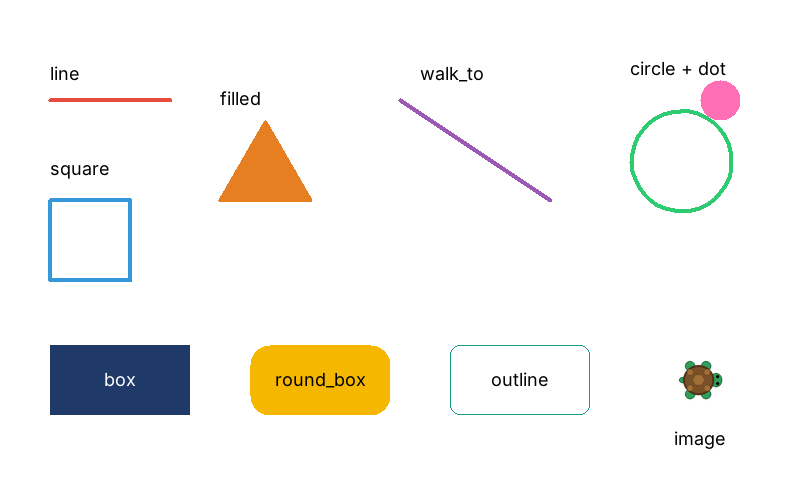

Want to see the pen? Call `arrow();` (or `picture("cat.png");` to make the pen a picture).
Leave it out and the pen is invisible.

## Pictures, GIFs and videos

```c
image("cat.png", 0, 0);           // png, jpg, bmp, tga, psd - built in
image("dance.gif", 200, 0);       // GIFs play their animation
image("clip.mp4", -200, 0);       // videos play (and loop) - mp4, webm, mkv, mov, avi
image("photo.webp", 0, -150);     // webp works too
sound("music.mp3");               // play a sound (mp3, wav, ogg - or a video's sound)
stop_sounds();
```

GIFs and videos can move and turn like any picture: `image("dance.gif", 0, 0) { move_to(300, 0); }`

Videos, webp and sound use `ffmpeg` (`sudo pacman -S ffmpeg` / `sudo apt install ffmpeg`).
Videos have no sound by themselves - add `sound("clip.mp4");` to hear it.
Big videos are shrunk to fit the window.

If a picture shows up as a **pink and black box**, crayon couldn't open it - the terminal says why.
Usually the file isn't in the folder you ran the program from, or it's not really the type its name says.

### More about pictures

```c
image("cat.png", 100, 50);        // picture with its middle at (100, 50)
image("cat.png", 100, 50, 2);     // twice as big
image("cat.png", 100, 50) {       // ...and move it (see "Move and turn" below)
    move_to(300, 50);
    rt(90);
}
```

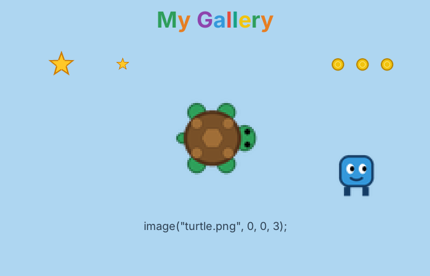

Or turn the pen itself into a picture — it still moves with `forward`, `left` and `right`:

```c
picture("turtle.png");
repeat(5) { forward(150); right(144); }
```

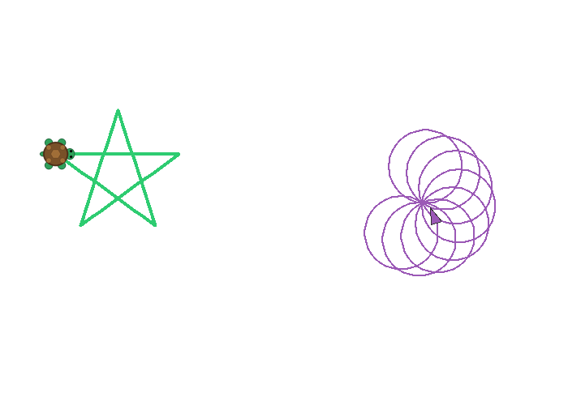

## Colorful text

```c
text("Hello", -200, 100);                         // words, x, y
text("{red}G{yellow}o{blue}o{green}d", 0, 0);     // a color for each part
text("{rainbow}Rainbow!", 0, -50);                // every letter a different color
text("Hi 😀 🐢 🔥", 0, -100);                       // emoji work too (in text and buttons)
text("Score: %d", -200, 150, score);              // numbers inside
text_center("Title", 0, 150);                     // centered on x, y
text("line one\nline two", 0, 100);               // \n = new line
textsize(40);
bold(1);
```

## Ask the user things

The program simply waits for the answer — no callbacks needed.

```c
const char *name = userinput("What's your name?");      // box at the bottom
text("{rainbow}Hi %s!", 0, 100, name);

const char *q = userinput("Search...", 0, 50);          // box at x 0, y 50

int choice = pick("Yes", "No");        // 1 = Yes, 2 = No
```

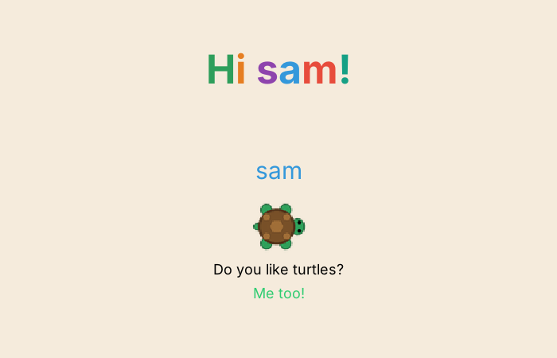

## Buttons, links and typing

```c
void play(void) { text("Let's go!", 0, 0); }

button("Play", 0, -100, play);         // words, x, y, what to do
link("Click me", -200, 50, play);
button_color("blue", "white");
```

A box you can type into — whatever you type can make new things appear:

```c
void got_it(void) {
    text(entry(), 0, 0);                              // print what they typed
    if (typed("party"))  background("pink");
    if (typed("button")) button("I'm new!", 0, -100, got_it);
}

inputbox("Type here...", 0, -200, 500, got_it);
```

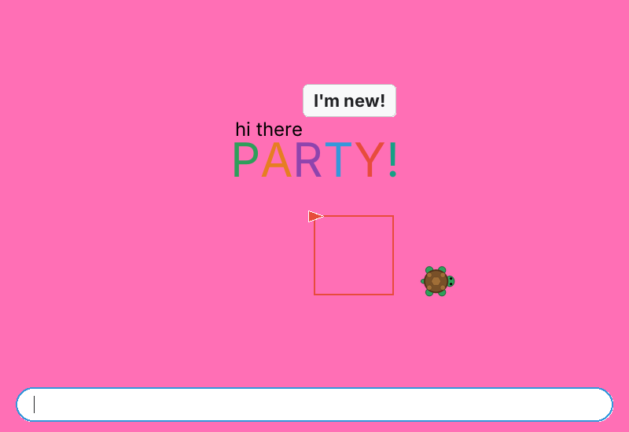

## Pages

```c
void settings(void) {
    new_screen();                      // wipe everything
    text("Settings", 0, 100);
    link("< Back", -50, 0, home);
}
```

Every page is just a function. A button or link says which one to open next.
That's how the search engine example below is built.

## Run commands

```c
const char *out = run("uname -r");          // runs it, waits, gives back what it printed
text(out, -300, 100);                       // multi-line output shows on multiple lines

run("pacman -Ss %s", word(1));              // %s puts in a word the user typed
run("sudo pacman -S %s", input);            // sudo asks for the password in the terminal

if (run_ok()) text("{green}worked!", 0, 0);
else          text("{red}%s", 0, 0, run_output());   // show the error
```

Every `%s` goes in as **one quoted word**, so whatever someone types can't sneak in extra commands
(`x; rm -rf ~` stays just text). `%d` works for numbers. The window keeps working while a command runs.

## Easy games (no loops)

```c
#include "crayon.h"

void got_coin(void) {
    add_score(1);
    respawn();                      // the coin jumps somewhere new
    if (score() == 15) you_win("YOU WIN!");
}

void got_hit(void) {
    lose_life();                    // you blink and are safe for a moment
    respawn();
}

int main(void) {
    window(800, 560);
    background("lightgreen");

    player("turtle.png");           // arrow keys or WASD move it
    spawn("coin.png", 5);           // 5 coins in random spots
    spawn("star.png", 2);           // 2 enemies

    on_touch("coin.png", got_coin); // touch a coin -> got_coin() runs
    on_touch("star.png", got_hit);

    spin_all("coin.png", 4);        // coins spin
    chase("star.png", 1);           // stars chase you

    show_score();
    lives(3);                       // 0 lives = game over (SPACE to play again)
}
```

That's the whole game - it starts by itself at the end of `main`.

| | |
|---|---|
| `player("x.png")` | you - arrow keys / WASD. `player_speed(8)`, `tank_controls()` |
| `spawn("x.png", 5)` / `spawn_at("x.png", x, y)` | put things in the world |
| `spawn("x.png", 5, 0.5)` / `player("x.png", 0.5)` / `size_all("x.png", 0.5)` | smaller (or bigger: `2`) |
| `on_touch("x.png", fn)` | run `fn()` when you touch one |
| inside that fn | `respawn()`, `remove_it()`, `it()` (the thing you touched) |
| `chase("x.png", speed)` / `spin_all("x.png", speed)` | make them chase you / spin |
| `add_score(1)`, `score()`, `show_score()` | score in the top-left |
| `lives(3)`, `lose_life()`, `lives_left()` | hearts in the top-right |
| `game_over("msg")`, `you_win("msg")` | end screen, SPACE plays again |

See `coins.c`.

### Enemies, health and hearts (only if you want them)

```c
enemies("ghost.png", 3);                      // 3 ghosts chase you and bite (10 damage)
enemies("ghost.png", 3, 1.5, 20);             // speed 1.5, 20 damage a bite
shoots("ghost.png", "fireball.png");          // they shoot at you every 2 seconds
shoots("ghost.png", "fireball.png", 1, 15);   // every 1 second, 15 damage

health(100);                                  // a health bar in the top-right
hearts(5);                                    // 5 hearts (each hit takes one)
hearts(3, "heart.png");                       // with your own heart picture
// use health() AND hearts() together: an empty bar costs a heart and refills

hurt(10);  heal(25);  health_left()           // do it yourself from any function

size_all("ghost.png", 0.6);                   // smaller ghosts
size_all("fireball.png", 0.5);                // smaller fireballs (works for ones shot later too)
```

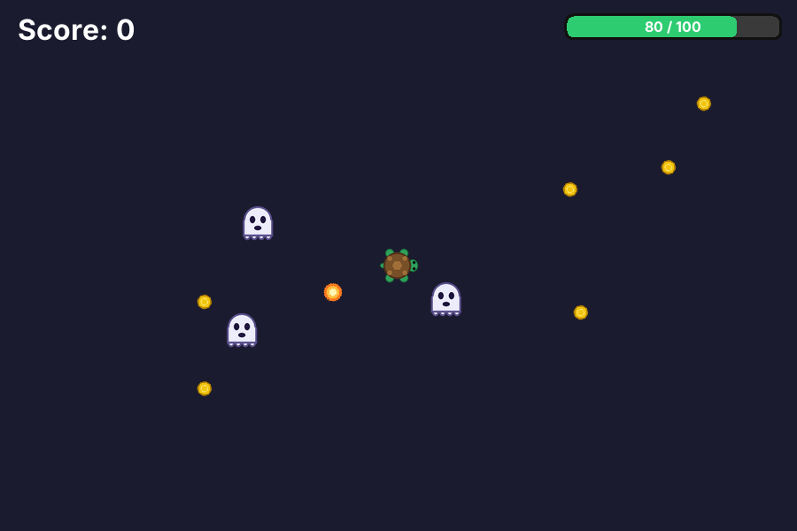

After a hit you blink and can't be hurt for a moment. `ghost.png`, `fireball.png` and `heart.png` are in the repo. See `battle.c`.

## Games (with forever)

```c
Turtle player = new_turtle();
picture("player.png");

forever {
    key(UP)    forward(4);
    key(LEFT)  left(5);
    key(RIGHT) right(5);
    press(SPACE) text("jump!", 0, 0);
}
```

Also: `touching(coin)`, `draggable()`, `clicked()`, `mouse_x()`, `rnd(1, 6)`.

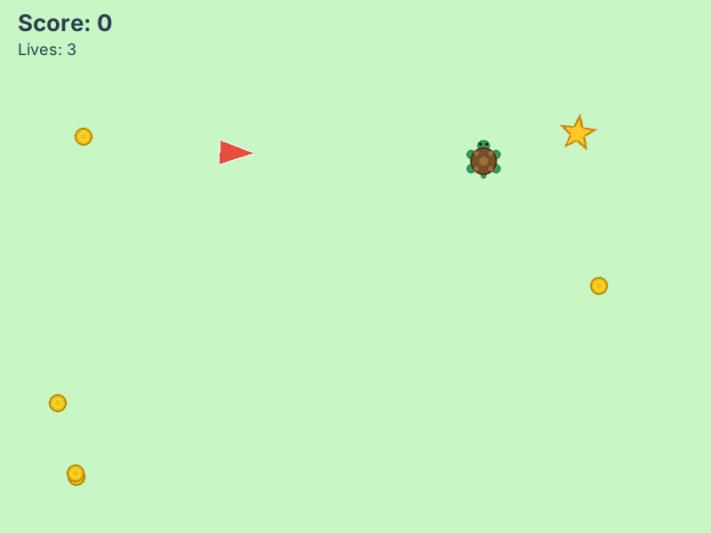

---

## Example: an "ask me anything" bot

A `while` loop + `userinput()` + `strstr()` = a chatbot. `strstr` checks if a word is anywhere in what
they typed, so "what is linux" still matches `"linux"`.

```c
#include "crayon.h"

void page(void) {
    clear();                                   // wipe the old answer
    image("coogle.png", 0, 120, 0.5);          // coogle.png is in this repo
    textsize(22);
    text_center("{white}Ask coogle anything!", 0, 40);
}

int main(void) {
    window(1000, 500);
    background("black");
    page();

    while (1) {
        const char *input = userinput("?:");
        page();                                // fresh screen for every question

        textsize(20);
        if (strstr(input, "gnu"))
            text_center("{white}GNU is free software you can use, change and share.", 0, -100);
        else if (strstr(input, "linux"))
            text_center("{white}Linux is a kernel made by {yellow}Linus Torvalds{white}.", 0, -100);
        else
            text_center("{gray}I don't know \"%s\" yet", 0, -100, input);
    }
}
```

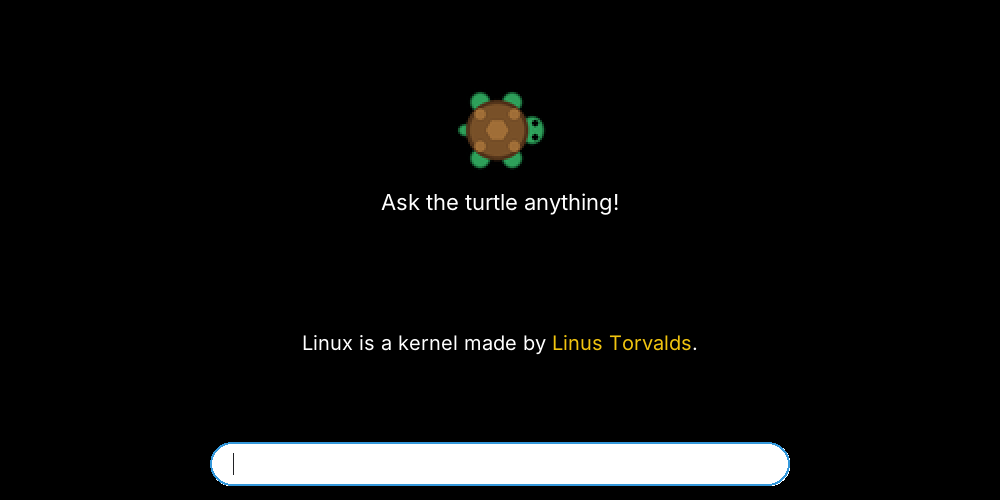

**Why the `page()` function?** Text stays on the screen until you `clear()` it. Without clearing,
every new answer would be drawn on top of the last one. `clear()` wipes everything, so `page()`
draws the picture and title again before each answer.

Tips:
- `strstr` cares about capitals — `"Linux"` won't match `"linux"`. Use `same(input, "linux")` for an exact match that ignores capitals.
- Always end with an `else` so the bot answers something even when it doesn't know the word.
- Closing the window ends the program, even inside `while (1)`.

---

## Example: a search engine in ~150 lines

`search.c` is a pretend search engine called **Turtlr**: home page, search box, buttons,
a results page and pretend websites — all made from `text()`, `link()`, `button()`,
`inputbox()` and `box()`.

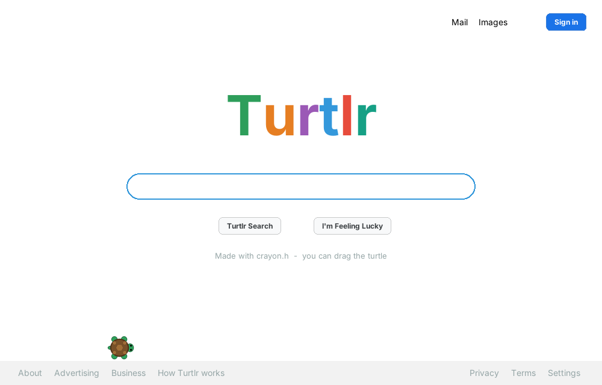
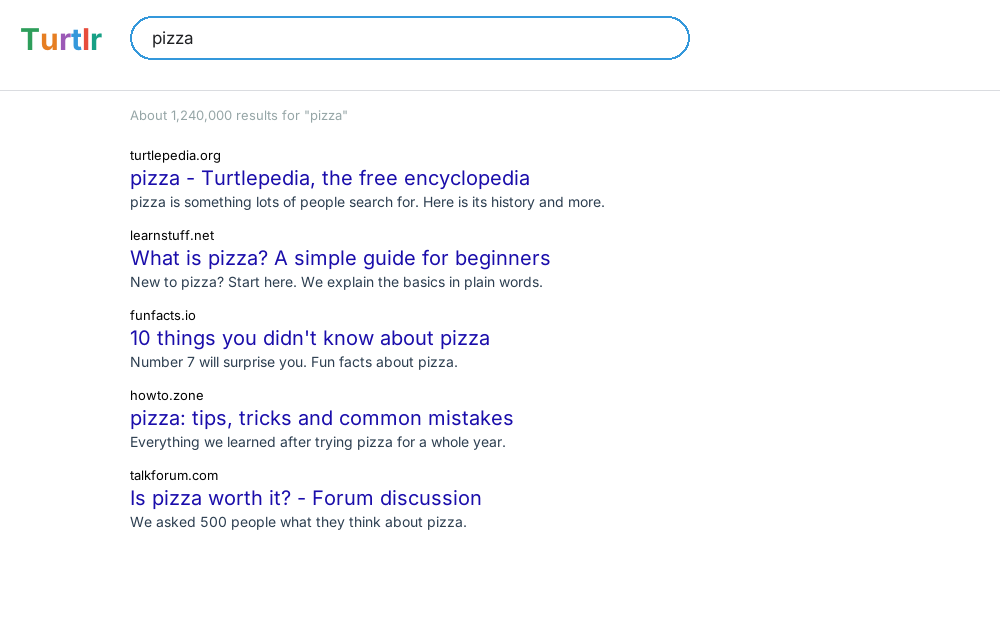

```c
void home(void) {
    new_screen();

    textsize(92);
    bold(1);
    text_center("{#2e9e5b}T{orange}u{purple}r{blue}t{red}l{teal}r", 0, 95);
    bold(0);

    inputbox("Search Turtlr or type a URL", 0, 10, 580, do_search);
    button("Turtlr Search", -85, -55, do_search);
    button("I'm Feeling Lucky", 85, -55, lucky);
}
```

---

## All the examples

| file | what it shows |
|---|---|
| `square.c` | the classic square |
| `draw.c` | every way to draw: lines, shapes, fills, boxes, pictures |
| `place.c` | buttons in every corner, with the coordinate grid |
| `gallery.c` | pictures anywhere with `image()` |
| `move.c` | move and turn pictures and text with `image(...) { move_to(); lt(); rt(); }` |
| `hello.c` | `userinput()`, `pick()` and rainbow text |
| `ask.c` | an "ask me anything" bot with `userinput()` and `strstr()` |
| `commands.c` | type words, new things appear |
| `pictures.c` | a picture pen and an arrow pen drawing together |
| `coins.c` | a full coin game with no loops: `player()`, `spawn()`, `on_touch()` |
| `battle.c` | ghosts that chase and shoot, with a health bar |
| `game.c` | a small arcade game |
| `search.c` | Turtlr, the pretend search engine |

```sh
gcc search.c -o search && ./search
```

## Speed

crayon only redraws the parts of the window that pictures cover, and keeps its own copy of your drawings.
On a 1280×720 window: 1 moving picture runs at ~1200 frames/sec, 300 at ~245, 1000 at ~100.
(`forever` and games are capped at 60 fps so they don't eat your CPU.) Up to 1024 things on screen.

## Requirements

Emoji need an emoji font installed (most desktops have one; on Arch: `sudo pacman -S noto-fonts-emoji`).

Linux with X11 or Wayland (XWayland). Uses `libX11` and (optionally) `libXft` for smooth text — both
already on any normal desktop Linux, loaded at runtime, so you never link anything. Pictures are decoded
by [stb_image](https://github.com/nothings/stb) (built in). Videos, webp and `sound()` need `ffmpeg`.

## Cheat sheet

```
window(w, h)  title("...")  background("color")  grid()  show_coords()
forward(n)  back(n)  left(deg)  right(deg)  face(deg)  go_to(x, y)  walk_to(x, y)  go_home()
color("red")  thickness(n)  penup()  pendown()  speed(0-10)  circle(r)  dot(size)
box(x, y, w, h)  round_box(x, y, w, h, r)  outline(x, y, w, h, r)  begin_fill()  end_fill()
clear()  new_screen()
arrow()  picture("x.png")  hide()  show()  turtle_size(n)  flip(1)  keep_upright()
image("x.png", x, y)  image("x.png", x, y, scale)
image("x.png/.gif/.mp4", x, y) { }  sound("x.mp3")  stop_sounds()  label("...", x, y) { }  move_to(x, y, speed)  move_by(dx, dy, speed)  lt(deg)  rt(deg)  spin(deg)
rotate(deg)  rotate_to(deg)  place(x, y)  resize(n)  glide(x, y, speed)  start_spin(deg, speed)  stamp("x.png", x, y)
add_image("x.png", x, y)  add_text("...", x, y)  change_text(t, "...")  things_touch(a, b)  drag_thing(t)
text("...", x, y)  text_center("...", x, y)  textsize(n)  bold(1)  say("...")
userinput("question")  userinput("question", x, y)  numberinput("question")  pick("A", "B")  wait_button()  wait_key()
button("words", x, y, fn)  link("words", x, y, fn)  button_color("bg", "text")
inputbox("hint", x, y, width, fn)  entry()  typed("x")  command("x")  word(n)  number(n)
new_turtle()  use(t)  touching(t)  clicked()  draggable()  xcor()  ycor()
run("cmd %s", word)  run_ok()  run_output()
player("x.png")  spawn("x.png", n)  on_touch("x.png", fn)  respawn()  remove_it()  chase("x.png", s)
add_score(n)  show_score()  lives(n)  lose_life()  game_over("..")  you_win("..")
enemies("x.png", n, speed, damage)  shoots("x.png", "bullet.png", sec, damage)  health(n)  hearts(n, "x.png")  hurt(n)  heal(n)
forever { }  key(k) { }  press(k) { }  mouse_x()  mouse_y()  rnd(a, b)  wait_for(sec)
```

## License

MIT — do whatever you want with it.
