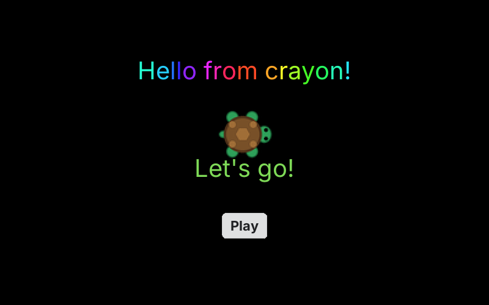
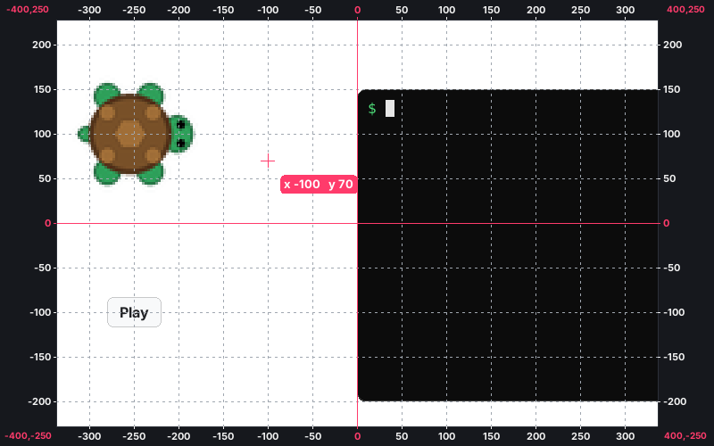
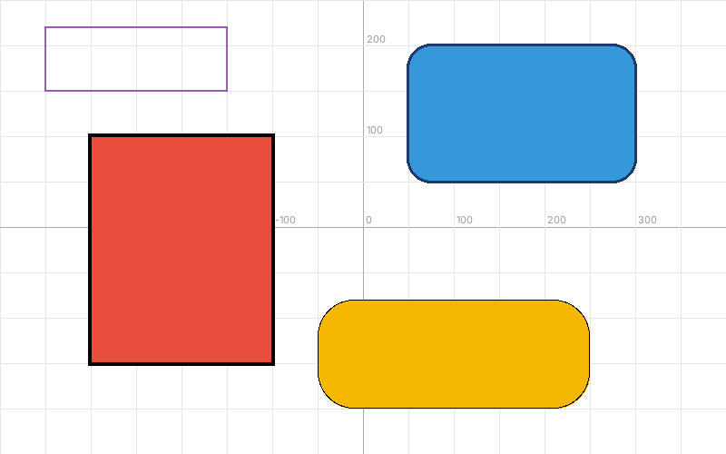
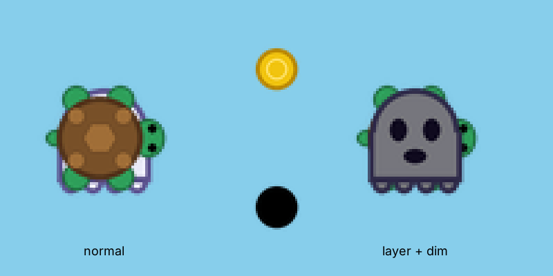
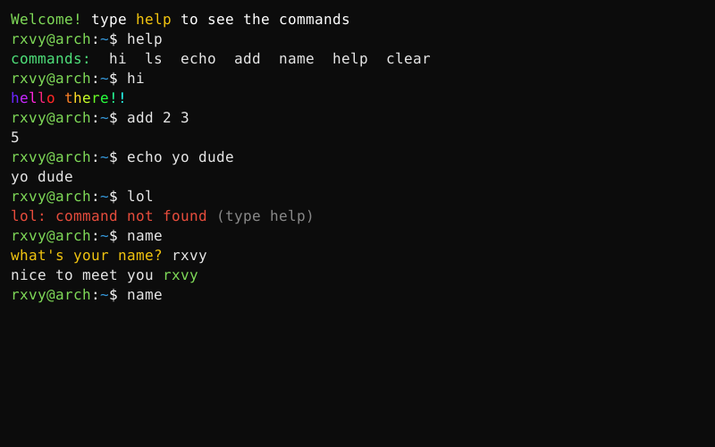
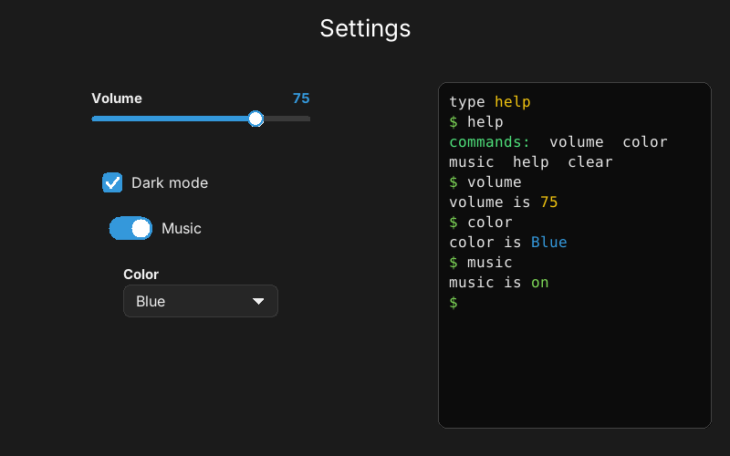

<div align="center">

# 🖍️ crayon.h

**The easiest way to draw, make games and make apps in C.**

One header file. No setup. Nothing to link. Just `#include` it and go.


</div>

```c
#include "crayon.h"

void start(void) { type_text_center("{lime}Let's go!", 0, -40); }

int main(void) {
    window(800, 500);
    background("black");
    textsize(40);
    text_center("{party}Hello from crayon!", 0, 120);   // moving rainbow text
    image("turtle.png", 0, 30, 2);                     // a picture, twice as big
    button("Play", 0, -120, start);                    // click it -> start() runs
}
```

```sh
gcc main.c -o main && ./main
```



That's the whole program. No event loop, no setup code, no cleanup. The window stays open by itself.


---

## Contents

**Start:** [Install](#install) · [Your first program](#your-first-program) · [Share ONE file](#-share-one-file-bundle) · [Why crayon?](#why-crayon)

**Basics:** [Coordinates](#coordinates-where-things-go) · [Colors](#colors) · [Text](#text) · [Moving & typing text](#moving-text-and-typing-text) · [Drawing](#drawing) · [Boxes](#boxes) · [Pictures, GIFs, videos & sound](#pictures-gifs-videos-and-sound) · [Moving pictures](#moving-and-turning-pictures) · [Layers & dimming](#layers-and-dimming)

**Apps:** [Buttons](#buttons-and-links) · [Asking things](#asking-the-user-things) · [Terminal](#terminal) · [Sliders, checkboxes, dropdowns](#sliders-checkboxes-switches-and-dropdowns) · [Loading bars](#loading-bars) · [Pages](#pages) · [Running commands](#running-commands)

**Games:** [Easy games](#easy-games-no-loops) · [Enemies & health](#enemies-health-and-hearts) · [Games with `forever`](#games-with-forever)

**More:** [Fullscreen](#fullscreen-and-closing) · [Examples](#examples) · [Speed](#speed) · [Requirements](#requirements) · [Cheat sheet](#cheat-sheet)

---

## Install

Download [`crayon.h`](crayon.h). Then pick one:

**Keep it next to your code.** Put `crayon.h` in the same folder as your `.c` file:

```c
#include "crayon.h"
```

**Or install it once and use it from any folder:**

```sh
sudo cp crayon.h /usr/local/include/
```

```c
#include <crayon.h>
```

Compile with plain gcc. No `-lX11`, no `-lm`, no CMake:

```sh
gcc main.c -o main && ./main
```

You don't need `#include <stdio.h>` or `<string.h>`, because crayon already includes them.

## Your first program

```c
#include "crayon.h"

int main(void) {
    window(600, 400);
    arrow();                  // show the pen as an arrow

    repeat(4) {               // a square
        forward(100);
        right(90);
    }
}
```


## 🔥 Share ONE file: `bundle()`

The peak feature. Put one `bundle()` line at the top for each picture, gif, video or sound,
and gcc packs them **inside** your program. Send just the program. No folder of files next to it.

```c
#include "crayon.h"

bundle("turtle.png");       // one line per file, at the top, outside main
bundle("coin.png");
bundle("music.mp3");

int main(void) {
    window(800, 600);
    sound("music.mp3");     // the rest of your code stays exactly the same
    player("turtle.png");
    spawn("coin.png", 5);
}
```

```sh
gcc game.c -o game     # compile in the folder where the files are
./game                 # now send just "game" to anyone
```

- The name in `bundle("...")` must match exactly what you use in `image()`, `sound()`, `player()` and so on.
- Works for anything: png, jpg, gif, webp, mp4, webm, mp3, wav, ogg...
- Videos, webp and sound still need `ffmpeg` on the computer that runs it.

## Why crayon?

Most C graphics libraries make you write 50 lines before you see one pixel:
make a renderer, load fonts, write an event loop, free everything at the end.
With crayon you write what you **mean**:

| You want to... | You write |
|---|---|
| draw a line | `forward(100);` |
| show a picture | `image("cat.png", 0, 0);` |
| write colorful text | `text("{red}Hi {blue}there", 0, 0);` |
| ask a question | `name = userinput("Your name?");` |
| make a button | `button("Play", 0, -100, start);` |
| make a game | `player("me.png"); spawn("coin.png", 5);` |
| make a terminal | `terminal("$ "); on_command("hi", hi);` |

---

# Basics

## Coordinates (where things go)

The middle of the window is **(0, 0)**. **x** goes right (negative = left). **y** goes up (negative = down).
A `window(800, 500)` goes from **-400 to 400** across and from **-250 to 250** up and down.

Every function that puts something on screen takes the **x, y** after the words:

```c
text("Hello", -300, 200);              // words start at (-300, 200)
text_center("Title", 0, 200);          // words centered on (0, 200)
button("Play", 0, -100, start);        // button centered on (0, -100)
image("logo.png", 0, 150);             // picture centered on (0, 150)
userinput("Name?", 0, 50);             // input box centered on (0, 50)
```

**Not sure where something goes?** Add `coords();`. You get lines every 50 on top of everything,
numbers on all 4 sides like a times table (each corner shows its own x,y), and the mouse's exact x, y next to it.
Hover where you want something, copy the numbers, then delete the line.

```c
coords();        // lines every 50
coords(100);     // lines every 100
coords_off();    // hide them
```



## Colors

Anywhere you give a color, use a **name** or a **hex code**:

```c
color("red");                          // a name
background("navy");
text("{pink}hi {lime}there", 0, 0);    // names inside text too

color("#ff8800");                      // a hex code = an exact shade
text("{#ff8800}orange words", 0, 0);
```

**Names:** red, green, blue, yellow, orange, purple, pink, cyan, brown, black, white, gray, darkgray,
lightgray, sky, grass, navy, lime, gold, teal, magenta, violet, darkgreen, darkblue, darkred,
lightblue, lightgreen, beige, silver, maroon, olive, linkblue, tomato, brightred

**Hex codes** are `#` + 6 characters: two for red, two for green, two for blue, each from `00` (none) to `ff` (full).
`"#ff0000"` is pure red and `"#ffffff"` is white. Copy one from any color picker.

## Text

```c
text("Hello", -200, 100);                         // words, x, y (x, y = where the words start)
text_center("Title", 0, 150);                     // x, y = the middle of the words
text("{red}G{yellow}o{blue}o{green}d", 0, 0);     // a color for each part
text("{rainbow}Rainbow!", 0, -50);                // every letter a different color
text("Score: %d", -200, 150, score);              // numbers inside, like printf
text("Hi 😀 🐢 🔥", 0, -100);                       // emoji work (in text and buttons)
text_center("{red}Title\nunder it", 0, 0);        // \n = new line (the color carries over)

textsize(40);                                     // bigger text from now on
bold(1);                                          // bold on (bold(0) = off)
```

`\n` works everywhere text goes: `text`, `text_center`, `label`, buttons, links, `type_text` and loading bars.

## Moving text and typing text

**Moving text:** put a tag in front of the words, just like a color:

```c
text("{party}PARTY TIME", 0, 100);       // a rainbow that MOVES
text("{wave}hello there", 0, 50);        // letters go up and down like a wave
text("{shake}{red}DANGER", 0, 0);        // shaky scary letters
text("{blink}press start", 0, -50);      // blinks on and off
text("{pulse}{cyan}glowing", 0, -100);   // fades in and out
text("{wave}wavy {still}not wavy", 0, -150);   // {still} stops the moving
```

**Typing text:** the letters show up one at a time, then your next line runs:

```c
type_text("Hello traveler...", -300, 100);             // x, y = where it starts
type_text_center("{red}Welcome to my game!", 0, 0);   // x, y = the middle
type_speed(60);                                         // faster (30 letters a second is normal)
```

Clicking or pressing SPACE or ENTER shows the rest right away.

## Drawing

crayon has a pen you move around. It draws a line wherever it goes.

```c
speed(0);                 // draw instantly (1 = slow ... 10 = fast)
color("red");
thickness(4);

forward(120);             // a line
right(90);                // turn
repeat(4) { forward(80); right(90); }      // a square

go_to(-200, 100);         // jump somewhere (doesn't draw)
walk_to(150, 50);         // a line from here to (150, 50)
circle(50);               // a circle
dot(40);                  // a filled dot

begin_fill();             // a filled triangle
repeat(3) { forward(90); left(120); }
end_fill();

penup();                  // move without drawing
pendown();                // draw again
clear();                  // erase everything
```


The pen is invisible until you show it: `arrow();` shows an arrow and `picture("cat.png");` makes the pen a picture.
A picture pen only draws lines after `pendown();`.

## Boxes

Give the **bottom-left** corner, the **top-right** corner and a color:

```c
box(-300, -150, -100, 100, "red");        // from (-300, -150) to (-100, 100)
box_outline("black", 4);                  // a border around the box you just made, 4 thick

box(50, 50, 300, 200, "blue", 25);        // last number = round corners (25 = how round)
box_outline("navy", 3);                   // the border follows the round corners

box_outline(-350, 150, -150, 220, "purple", 2);   // a border on its own, anywhere
```



## Pictures, GIFs, videos and sound

```c
image("cat.png", 0, 0);           // picture with its middle at (0, 0): png, jpg, bmp, tga, psd
image("cat.png", 200, 0, 2);      // twice as big (0.5 = half size)
image("dance.gif", -200, 0);      // GIFs play their animation
image("clip.mp4", 0, -150);       // videos play and loop: mp4, webm, mkv, mov, avi (and webp)
sound("music.mp3");               // play a sound: mp3, wav, ogg, or a video's sound
stop_sounds();
```


- Videos, webp and sound use `ffmpeg` (`sudo pacman -S ffmpeg` or `sudo apt install ffmpeg`).
- Videos have no sound by themselves. Add `sound("clip.mp4");` to hear it.
- A **pink and black box** means crayon couldn't open the file, and the terminal says why.
  Usually the file isn't in the folder you ran the program from.
- The file name can come from a variable, like `image(userinput("Which picture?"), 0, 0);`.

## Moving and turning pictures

Put `{ }` after a picture or text, and everything inside moves **that** thing:

```c
image("turtle.png", -300, 0) {
    move_to(300, 0);        // slide to (300, 0)
    lt(90);                 // turn left 90
    move_by(0, 100, 8);     // go up 100, at speed 8
    spin(360, 12);          // spin all the way around, fast
}

label("{rainbow}Hello! 🐢", 0, -200) {   // label = text you can move
    move_to(0, -100);
    rt(20);                 // tilt it
}
```

| inside `{ }` | what it does |
|---|---|
| `move_to(x, y)` / `move_to(x, y, speed)` | slide to a spot |
| `move_by(100, 0)` / `move_by(dx, dy, speed)` | slide 100 to the right |
| `lt(90)` / `rt(90)` | turn left / right (add a speed: `rt(90, 10)`) |
| `spin(360)` / `spin(360, 12)` | spin around |
| `rotate(45)` / `rotate_to(0)` | turn instantly / set the exact angle |
| `place(x, y)` | jump there instantly |
| `resize(2)` | twice as big |
| `glide(x, y, speed)` / `start_spin(deg, speed)` | start moving but **don't wait** |
| `wait_for(1)` | pause a second |

Speed: `1` = slow, `5` = normal, `20` = fast, `0` = instant. Everything waits until it's done, except `glide` and `start_spin`.

**Want to move it again later?** Give it a name:

```c
Thing cat = add_image("cat.png", 0, 0);
Thing score = add_text("Score: 0", -300, 200);

move_to(cat, 300, 0, 5);           // the name goes first
change_text(score, "Score: %d", 10);
if (things_touch(cat, score)) { ... }
drag_thing(cat);                   // drag it with the mouse
```

## Layers and dimming

Pick which picture goes on top: **1 = the very bottom, 100 = on top of everything.**
If you don't say, pictures are 50 and the newest one goes on top.

```c
layer("background.png", 1);     // all the way at the back
layer("player.png", 100);       // always on top
```

Make a picture darker: **0.0 = normal, 0.5 = half dark, 1.0 = pitch black.**

```c
dim("tree.png", 0.5);
dim("ghost.png", 1.0);          // a black shadow
```

The file name changes **every** picture with that name, even ones made later. For just one:
`Thing cat = add_image("cat.png", 0, 0); layer(cat, 90); dim(cat, 0.3);`



---

# Apps

## Buttons and links

```c
void hi(void) {                          // what happens when it's clicked
    text_center("{green}You clicked!", 0, 40);
}

int main(void) {
    window(800, 500);
    button("Click me", 0, 0, hi);        // words, x, y, function
    link("or me", 0, -60, hi);           // same, but it looks like clickable text
}
```

- `button_color("blue", "white");` sets the button color and its words. Call it **before** making the button.
- `textsize(20);` before a button makes its words bigger.
- `remove_button("Click me");` takes one away, and `new_screen();` removes everything.

Want to wait for a click instead of using a function?

```c
button("Yes", -60, 0);
button("No", 60, 0);
if (same(wait_button(), "Yes")) text("yay", 0, -60);
```

## Asking the user things

The program waits for the answer. No callbacks needed:

```c
const char *name = userinput("What's your name?");      // box at the bottom
text("{rainbow}Hi %s!", 0, 100, name);

const char *q = userinput("Search...", 0, 50);          // box at x 0, y 50
float age = numberinput("How old are you?");            // gives back a number
int answer = pick("Yes", "No");                         // 1 = Yes, 2 = No
int k = wait_key();                                     // waits for a key
```


An input box that stays on screen and runs a function every time someone presses Enter:

```c
void got_it(void) {
    text(entry(), 0, 0);                              // what they typed
    if (typed("party")) background("pink");
}

inputbox("Type here...", 0, -200, 500, got_it);       // hint, x, y, width, function
```

Color any input box: `input_color("black", "white");` (box, words) or `input_color("black", "white", "red");` (+ border).

## Terminal

A box you type commands into, like a real terminal. Write a function for each command, then connect them. No loops:

```c
void hi(void)   { terminal_print("hello!"); }
void echo(void) { terminal_print("%s", rest(1)); }    // rest(1) = everything after "echo"
void ls(void)   { run("ls"); terminal_print("%s", run_output()); }

int main(void) {
    window(800, 500);
    terminal("$ ");                    // the whole window is a terminal, with a "$ " prompt
    terminal_print("type help");

    on_command("hi", hi);              // typing  hi  runs hi()
    on_command("echo", echo);
    on_command("ls", ls);
}
```



You get these for free:

| | |
|---|---|
| `help` | lists your commands |
| `clear` or Ctrl+L | wipes the screen |
| Tab | finishes a command (`ec` → `echo`) |
| Up / Down | your old commands |
| Left / Right / Home / End | move the cursor |
| Ctrl+U / Ctrl+C | clear the line / cancel |
| PageUp / PageDown / mouse wheel | scroll back |
| a wrong command | `lol: command not found (type help)` |

Inside a command function, these tell you what was typed after the command:

```c
word(1)      // the 1st word after it          give apple    ->  "apple"
number(1)    // that word as a number          add 2 3       ->  2   (print it with %g)
rest(1)      // everything after it            echo yo dude  ->  "yo dude"
```

```c
terminal(0, -200, 350, 150, "$ ");               // a terminal BOX: bottom-left corner, top-right corner
const char *name = terminal_input("Name? ");     // ask something and wait for the answer
terminal_color("black", "white", "lime");        // background, text, prompt
terminal_textsize(20);                            // bigger letters (16 is normal)
terminal_clear();
on_command("*", fn);                              // runs for anything that isn't one of your commands
```

## Sliders, checkboxes, switches and dropdowns

Make them with a **name**, then read them anywhere with that name. No loops:

```c
slider("Volume", 0, 100, -180, 120);              // name, min, max, x, y (add a 6th number to set the start)
checkbox("Dark mode", -230, 50);
toggle("Music", -230, 0);                         // an on/off switch
dropdown("Color", "Red|Green|Blue", -180, -80);   // the choices, split by |
```

```c
value("Volume")       // 0 ... 100
value("Dark mode")    // 1 = ticked, 0 = not
value("Music")        // 1 = on, 0 = off
choice("Color")       // "Red", "Green" or "Blue"

on_change("Dark mode", fn);    // fn runs every time it changes
set_value("Volume", 30);       // change it from your code
control_color("red");          // color of knobs, ticks and switches (before making them)
```



## Loading bars

An installer-style bar with moving stripes and a % number:

```c
loading("Installing...", 5);              // fills up in 5 seconds, THEN the next line runs
loading("Installing...", 5, 0, -150);     // at a spot (x, y = the middle of the bar)
```

Set the % yourself while you do anything:

```c
progress("Installing stuff...", 0);
run("sudo pacman -S --noconfirm git");
progress(50);                              // slides smoothly to 50%
run("sudo pacman -S --noconfirm ffmpeg");
progress(100);
```

`start_loading("Charging...", 10);` fills by itself without waiting, and `loading_done()` tells you when it's full.
`loading_color("red");`, `loading_size(500, 30);` and `hide_loading();` change how it looks.

## Pages

Every page is just a function. A button or link says which page to open next:

```c
void home(void);

void settings(void) {
    new_screen();                      // wipe everything
    text_center("Settings", 0, 100);
    link("< Back", 0, 0, home);
}

void home(void) {
    new_screen();
    text_center("Home", 0, 100);
    button("Settings", 0, 0, settings);
}

int main(void) { window(800, 500); home(); }
```

## Running commands

```c
const char *out = run("uname -r");          // runs it, waits, gives back what it printed
text(out, -300, 100);

run("pacman -Ss %s", word(1));              // %s puts in a word the user typed
if (run_ok()) text("{green}worked!", 0, 0);
else          text("{red}%s", 0, 0, run_output());   // show the error
```

Every `%s` goes in as **one quoted word**, so whatever someone types can't sneak in extra commands
(`x; rm -rf ~` stays just text). `sudo` asks for the password in the terminal you started the program from.
The window keeps working while a command runs.

---

# Games

## Easy games (no loops)

```c
#include "crayon.h"

void got_coin(void) {
    add_score(1);
    respawn();                      // the coin jumps somewhere new
    if (score() == 15) you_win("YOU WIN!");
}

void got_hit(void) {
    lose_life();                    // you blink and are safe for a moment
    respawn();
}

int main(void) {
    window(800, 560);
    background("lightgreen");

    player("turtle.png");           // arrow keys or WASD move it
    spawn("coin.png", 5);           // 5 coins in random spots
    spawn("star.png", 2);           // 2 enemies

    on_touch("coin.png", got_coin); // touch a coin -> got_coin() runs
    on_touch("star.png", got_hit);

    spin_all("coin.png", 4);        // coins spin
    chase("star.png", 1);           // stars chase you

    show_score();
    lives(3);                       // 0 lives = game over (SPACE to play again)
}
```

That's the whole game. It starts by itself at the end of `main`.

| | |
|---|---|
| `player("x.png")` | you: arrow keys / WASD. `player_speed(8)`, `tank_controls()` |
| `spawn("x.png", 5)` / `spawn_at("x.png", x, y)` | put things in the world |
| `spawn("x.png", 5, 0.5)` / `player("x.png", 0.5)` / `size_all("x.png", 0.5)` | smaller (or bigger: `2`) |
| `on_touch("x.png", fn)` | run `fn()` when you touch one |
| inside that function | `respawn()`, `remove_it()`, `it()` (the thing you touched) |
| `chase("x.png", speed)` / `spin_all("x.png", speed)` | make them chase you / spin |
| `add_score(1)`, `score()`, `show_score()` | score in the top-left |
| `lives(3)`, `lose_life()`, `lives_left()` | hearts in the top-right |
| `game_over("msg")`, `you_win("msg")` | end screen, SPACE plays again |

## Enemies, health and hearts

Only if you want them:

```c
enemies("ghost.png", 3);                      // 3 ghosts chase you and bite (10 damage)
enemies("ghost.png", 3, 1.5, 20);             // speed 1.5, 20 damage a bite
shoots("ghost.png", "fireball.png");          // they shoot at you every 2 seconds
shoots("ghost.png", "fireball.png", 1, 15);   // every 1 second, 15 damage

health(100);                                  // a health bar in the top-right
hearts(5);                                    // 5 hearts (each hit takes one)
hearts(3, "heart.png");                       // with your own heart picture
hurt(10);  heal(25);  health_left()           // do it yourself from any function
```


After a hit you blink and can't be hurt for a moment. Use `health()` and `hearts()` together, and an empty bar costs a heart and refills.

## Games with `forever`

For full control, `forever { }` runs 60 times a second:

```c
Thing me = add_image("player.png", 0, 0);

forever {
    key(UP)    move_by(me, 0, 4, 0);
    key(DOWN)  move_by(me, 0, -4, 0);
    press(SPACE) text("jump!", 0, 0);       // key = held down, press = just pressed
}
```

Also: `mouse_x()`, `mouse_y()`, `rnd(1, 6)`, `things_touch(a, b)`, `wait_for(0.5)`.


---

# More

## Fullscreen and closing

```c
fullscreen();              // use instead of window(): the whole screen, no bars or borders
exit_key(ESC);             // optional: this key closes it (add more: exit_key('q');)
quit();                    // close it from your code, like button("Quit", 0, -100, quit);
```

Without `exit_key()`, no key closes the program. That's handy for a video your cat can smash keys on.
Your system's own close shortcut (like Alt+F4) still works.

`window_width()`, `window_height()`, `left_edge()`, `right_edge()`, `top_edge()` and `bottom_edge()` tell you where the edges are.
`title("My App");` changes the window's name.

## Examples

| file | what it shows |
|---|---|
| `square.c` | the classic square |
| `draw.c` | every way to draw: lines, shapes, fills, boxes, pictures |
| `place.c` | buttons in every corner, with the coordinate grid |
| `gallery.c` | pictures anywhere with `image()` |
| `move.c` | move and turn pictures and text |
| `pictures.c` | a picture pen and an arrow pen drawing together |
| `hello.c` | `userinput()`, `pick()` and rainbow text |
| `ask.c` | an "ask me anything" bot with `userinput()` and `strstr()` |
| `commands.c` | type words and new things appear |
| `shell.c` | a full-window terminal with commands |
| `controls.c` | a settings page: slider, checkbox, switch, dropdown and a terminal box |
| `search.c` | Turtlr, a pretend search engine in ~150 lines |
| `coins.c` | a coin game with no loops |
| `battle.c` | ghosts that chase and shoot, with a health bar |
| `game.c` | a small arcade game |

```sh
gcc search.c -o search && ./search
```


## Speed

Fast even with plain `gcc main.c`: the parts that draw pixels always build optimized, so you don't need `-O2`,
and compiling still takes about a second.
It shares picture memory straight with the X server (MIT-SHM), only redraws the parts of the window
that pictures cover, and keeps a ready-to-draw copy of every picture.

Same scenes, same pictures, 1280×720 window, milliseconds per frame (lower = faster):

| Scene | crayon.h | SDL2 (OpenGL) | SDL2 (software) |
|---|---|---|---|
| empty frame | **0.48** | 0.97 | 6.2 |
| 300 sprites moving | **2.4** | 2.3 | 7.3 |
| 300 sprites rotating | **2.4** | 2.1 | 8.0 |
| 300 sprites 3x size | **4.9** | 6.1 | 13.9 |
| fullscreen picture + 50 sprites | **3.7** | 5.0 | 10.7 |

Measured on a machine with no graphics card, so SDL's OpenGL ran on the CPU too.
With a real GPU, SDL's OpenGL renderer will win on scenes with thousands of big sprites.
For normal crayon programs you'll be at 60 fps with lots of room to spare.
`forever` and games are capped at 60 fps so they don't eat your CPU. Up to 1024 things on screen.

## Requirements

- Linux with X11, or Wayland (through XWayland, which every Wayland desktop has).
- `libX11` and `libXft`, which every normal desktop Linux already has. They're loaded when the program starts, so you never link anything.
- `ffmpeg` for videos, webp and `sound()`.
- An emoji font for emoji (most desktops have one; on Arch: `sudo pacman -S noto-fonts-emoji`).

Pictures are read by [stb_image](https://github.com/nothings/stb), which is built in.

## Cheat sheet

| Window | |
|---|---|
| `window(w, h)` `fullscreen()` `title("...")` `background("color")` | make it |
| `exit_key(ESC)` `quit()` | closing |
| `coords()` `coords(100)` `coords_off()` `grid()` `show_coords()` | find your x, y |
| `clear()` `new_screen()` | wipe the drawings / wipe everything |
| `bundle("file")` | pack a file into the program |

| Drawing | |
|---|---|
| `forward(n)` `back(n)` `left(deg)` `right(deg)` `face(deg)` | move the pen |
| `go_to(x, y)` `walk_to(x, y)` `go_home()` | jump / draw to a spot |
| `color("red")` `thickness(n)` `penup()` `pendown()` `speed(0-10)` | pen settings |
| `circle(r)` `dot(size)` `begin_fill()` `end_fill()` `repeat(n) { }` | shapes |
| `box(x1, y1, x2, y2, "color", round)` `box_outline("color", thick)` | boxes |
| `arrow()` `picture("x.png")` `hide()` `show()` `turtle_size(n)` | how the pen looks |

| Text | |
|---|---|
| `text("...", x, y)` `text_center("...", x, y)` `textsize(n)` `bold(1)` | words |
| `{red}` `{#ff8800}` `{rainbow}` `{party}` `{wave}` `{shake}` `{blink}` `{pulse}` `{still}` | tags inside text |
| `type_text("...", x, y)` `type_text_center("...", x, y)` `type_speed(n)` | typing |
| `label("...", x, y) { }` `add_text("...", x, y)` `change_text(t, "...")` | text you can move |

| Pictures and sound | |
|---|---|
| `image("x.png", x, y)` `image("x.png", x, y, scale)` `image(...) { }` | pictures, gifs, videos |
| `add_image("x.png", x, y)` `stamp("x.png", x, y)` | a picture you can move / paint one on |
| `move_to(x, y, speed)` `move_by(dx, dy, speed)` `lt(deg)` `rt(deg)` `spin(deg)` | move it |
| `rotate(deg)` `rotate_to(deg)` `place(x, y)` `resize(n)` `glide(x, y, speed)` | more moving |
| `layer("x.png", 1-100)` `dim("x.png", 0-1)` | on top / darker |
| `things_touch(a, b)` `drag_thing(t)` | touching / dragging |
| `sound("x.mp3")` `stop_sounds()` | sound |

| Apps | |
|---|---|
| `button("words", x, y, fn)` `link("words", x, y, fn)` `button_color("bg", "text")` | buttons |
| `userinput("?")` `userinput("?", x, y)` `numberinput("?")` `pick("A", "B")` | ask and wait |
| `wait_button()` `wait_key()` `wait_click()` `wait_for(sec)` | wait |
| `inputbox("hint", x, y, width, fn)` `entry()` `typed("x")` `input_color("bg", "text", "border")` | input box |
| `terminal("$ ")` `terminal(x1, y1, x2, y2, "$ ")` `on_command("name", fn)` | terminal |
| `terminal_print("...")` `terminal_input("?")` `terminal_clear()` `terminal_color(...)` | terminal |
| `word(n)` `number(n)` `rest(n)` `command("x")` `same(a, b)` | what was typed |
| `slider("name", min, max, x, y)` `checkbox(...)` `toggle(...)` `dropdown("name", "A\|B", x, y)` | controls |
| `value("name")` `choice("name")` `on_change("name", fn)` `set_value("name", n)` | read controls |
| `loading("...", sec)` `progress("...", pct)` `start_loading(...)` `loading_done()` | loading bars |
| `run("cmd %s", word)` `run_ok()` `run_output()` | shell commands |

| Games | |
|---|---|
| `player("x.png")` `spawn("x.png", n)` `spawn_at("x.png", x, y)` `size_all("x.png", n)` | things |
| `on_touch("x.png", fn)` `respawn()` `remove_it()` `it()` | touching |
| `chase("x.png", speed)` `spin_all("x.png", speed)` | movement |
| `add_score(n)` `show_score()` `lives(n)` `lose_life()` `game_over("..")` `you_win("..")` | score and lives |
| `enemies("x.png", n, speed, damage)` `shoots("x.png", "bullet.png", sec, damage)` | enemies |
| `health(n)` `hearts(n, "x.png")` `hurt(n)` `heal(n)` | health |
| `forever { }` `key(k)` `press(k)` `mouse_x()` `mouse_y()` `rnd(a, b)` | loops and input |

## License

MIT. Do whatever you want with it.
